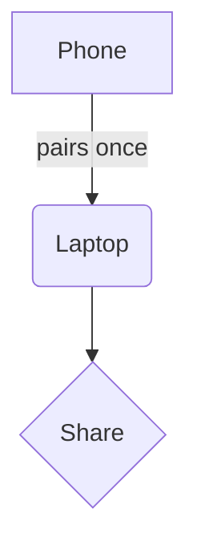

# Implementation plan

Some **bold**, *italic*, ==marked== and `inline code` text. A [link to other](other.md#setup) and an [external link](https://example.com). Footnote here[^1].

> [!NOTE]
> Alerts work like on GitHub.

> [!WARNING]
> Careful with this.

## Tasks

- [x] Server
- [ ] App
  - [ ] Reader

| Column | Another column | Third |
|---|---|---|
| a | b with a fairly long piece of text that wraps | c |
| 1 | 2 | 3 |

```rust
fn main() {
    // comment
    let x: u32 = 42;
    println!("hello {x}");
}
```

```ts
const greet = (name: string) => `hi ${name}`;
```

Inline math $e^{i\pi} + 1 = 0$ and block:

$$
\int_0^\infty e^{-x^2}\,dx = \frac{\sqrt{\pi}}{2}
$$



### Setup


<details><summary>More</summary>

Hidden content.

</details>

[^1]: The footnote text.
